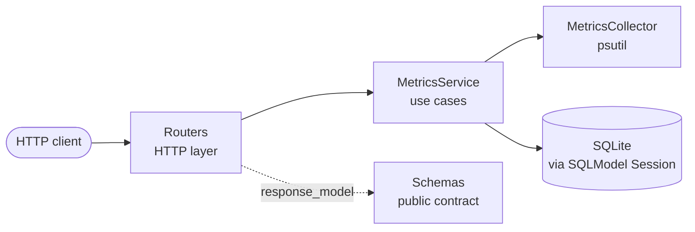
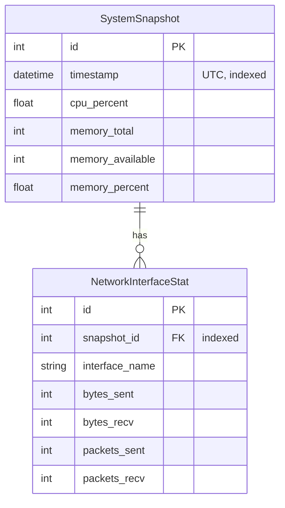

# 🖥️ FastAPI SysMonitor


A REST backend that collects host system metrics (CPU, memory, per-interface network counters) with `psutil`, persists them in SQLite through SQLModel, and exposes them over a typed, self-documented HTTP API.

It is the evolution of [`sysmetrics-pandas-logger`](https://github.com/EliaGiolli/sysmetrics-pandas-logger), a CLI collector that appended metrics to CSV files. Moving from flat files to a relational model and an HTTP API makes the data queryable, validated and ready to be consumed by other services.

---

## 📑 Table of Contents

- [Goals](#-goals)
- [Tech Stack](#-tech-stack)
- [Architecture](#-architecture)
- [Data Model](#-data-model)
- [Project Structure](#-project-structure)
- [Getting Started](#-getting-started)
- [API](#-api)
- [Design Notes](#-design-notes)
- [Known Limitations](#-known-limitations)
- [Roadmap](#-roadmap)

---

## 🎯 Goals

- **From files to a service**: replace CSV persistence with a relational database behind a REST API.
- **Strict contracts**: request/response shapes are explicit, typed and validated (Pydantic/SQLModel), and published as OpenAPI.
- **Clear layering**: HTTP, business logic, data collection and persistence are separate and independently testable.
- **Production habits**: reproducible environment, migrations, tests, containerization and CI (see the [Roadmap](#-roadmap)).

## 🛠️ Tech Stack

| Area | Choice |
|---|---|
| Language | Python 3.13 |
| Web framework | FastAPI (`fastapi[standard]`) served by Uvicorn |
| ORM / validation | SQLModel (SQLAlchemy + Pydantic) |
| Database | SQLite |
| System metrics | psutil |
| Tooling | uv (dependencies, lockfile, `src/` layout, `uv_build` backend) |
| API docs | Swagger UI (`/docs`) and ReDoc (`/redoc`), generated from the code |

## 🧱 Architecture

The application is organized in layers. Dependencies point in one direction only: **routers → services → collectors / models**.



| Layer | Responsibility |
|---|---|
| **Routers** | HTTP concerns only: routing, status codes, request/response models |
| **Services** | Use cases (collect and persist a snapshot); receive their dependencies via the constructor |
| **Collectors** | Read raw metrics from the OS; hidden behind a `Protocol` so they can be swapped or faked in tests |
| **Models** | Database tables (`table=True`) and the base field definitions they share with the schemas |
| **Schemas** | The public API contract, kept separate from the table definitions |

## 🗄️ Data Model

One snapshot has one CPU/memory reading and many network interfaces (one-to-many).



Shared fields live in plain `*Base` classes (no `table=True`) that are inherited by both the table model and the public schema, so each field is declared once.

## 📂 Project Structure

```text
fastapi-system-monitor/
├── pyproject.toml
├── uv.lock
├── README.md
└── src/
    └── fastapi_system_monitor/
        ├── __init__.py
        ├── main.py                  # FastAPI app, lifespan, router registration
        ├── core/
        │   └── database.py          # engine, session dependency (SessionDep)
        ├── models/
        │   └── metrics.py           # SystemSnapshot, NetworkInterfaceStat (+ Base classes)
        ├── schemas/
        │   └── metrics.py           # SystemSnapshotPublic, NetworkInterfaceStatPublic
        ├── services/
        │   ├── collectors.py        # MetricsCollector (Protocol), PsutilCollector
        │   └── metrics_service.py   # MetricsService: collect and persist a snapshot
        └── routers/                 # HTTP endpoints (next step)
```

## 🚀 Getting Started

**Requirements:** Python 3.13+ and [uv](https://docs.astral.sh/uv/).

```bash
git clone https://github.com/EliaGiolli/FastAPI-SysMonitor.git
cd FastAPI-SysMonitor

uv sync                                                        # create the venv and install dependencies
uv run uvicorn fastapi_system_monitor.main:app --reload        # start the dev server
```

- Interactive docs: <http://127.0.0.1:8000/docs>
- Health check: <http://127.0.0.1:8000/health>

On startup the lifespan handler creates the tables if they do not exist. The SQLite file `sysmonitor.db` is created **in the directory the server is launched from**.

## 🔌 API

| Method | Path | Description | Status |
|---|---|---|---|
| `GET` | `/health` | Liveness check | ✅ Available |
| `POST` | `/metrics` | Collect the current metrics and store a snapshot | 🚧 Planned |
| `GET` | `/metrics` | List snapshots (pagination, date-range filter) | 🚧 Planned |
| `GET` | `/metrics/{id}` | Retrieve a single snapshot (404 if missing) | 🚧 Planned |
| `DELETE` | `/metrics/{id}` | Delete a snapshot and its interface rows | 🚧 Planned |
| `GET` | `/metrics/stats` | Aggregates over a period (avg/max CPU, memory) | 🚧 Planned |

The response contract is already defined by `SystemSnapshotPublic`:

```json
{
  "id": 1,
  "timestamp": "2026-11-19T12:29:06.620946Z",
  "cpu_percent": 12.5,
  "memory_total": 17179869184,
  "memory_available": 6442450944,
  "memory_percent": 62.5,
  "interfaces": [
    {
      "id": 1,
      "interface_name": "Ethernet",
      "bytes_sent": 1048576,
      "bytes_recv": 5242880,
      "packets_sent": 3200,
      "packets_recv": 6100
    }
  ]
}
```

## 🧠 Design Notes

- **Table models are not the API contract.** Tables describe storage; the public schemas describe what clients see. Clients never set `id` or `timestamp`, and renaming a column does not break the API.
- **Two tables instead of nested objects.** A relational column holds scalar values, and a snapshot has many network interfaces, so the nested structure becomes a one-to-many relationship. Memory, which is one value set per snapshot, is flattened into columns.
- **Dependency injection with a `Protocol`.** `MetricsService` depends on the `MetricsCollector` protocol, not on `psutil`. Production uses `PsutilCollector`; tests can inject a fake with deterministic data.
- **Collectors fail loudly.** Errors are not swallowed into empty results; they propagate and are translated to HTTP errors at the router layer.
- **Timestamps are UTC.** SQLite does not store time zones, so values are always written in UTC and converted only at presentation time.
- **`default_factory` for generated defaults**, so each row gets its own timestamp instead of one value computed at import time.

## ⚠️ Known Limitations

- **No migrations yet.** `create_all` only creates missing tables; it never alters existing ones. Schema changes need Alembic (roadmap).
- **SQLite does not enforce foreign keys by default.** `PRAGMA foreign_keys=ON` must be enabled per connection (roadmap).
- **Database location depends on the working directory** until configuration is externalized.
- **Collection blocks for about one second.** `psutil.cpu_percent(interval=1)` samples over one second; endpoints that call it must be plain `def` so FastAPI runs them in the thread pool instead of blocking the event loop.
- **All interfaces are stored**, including idle ones with zero counters.
- No authentication or rate limiting.

## 🗺️ Roadmap

**Done**
- [x] Project migrated to a single `src/` package managed with uv
- [x] `.gitignore`, reproducible dependencies (`uv.lock`)
- [x] SQLite persistence with SQLModel: `SystemSnapshot` and `NetworkInterfaceStat` tables
- [x] Application lifespan creating the schema at startup, `/health` endpoint
- [x] Public response schemas with shared base models
- [x] `psutil` collector behind a `Protocol`
- [x] `MetricsService` collecting and persisting snapshots (add / commit / refresh)

**Next: API**
- [ ] Routers with `Depends` wiring (session, collector, service)
- [ ] `POST /metrics` and `GET /metrics` with pagination (`offset`/`limit`) and date-range filters
- [ ] `GET /metrics/{id}`, `DELETE /metrics/{id}` with proper `HTTPException` (404)
- [ ] Aggregated statistics endpoint
- [ ] Enable SQLite foreign key enforcement

**Quality and operations**
- [ ] Tests with `pytest`: `TestClient`, in-memory SQLite, `dependency_overrides`, fake collector
- [ ] Typed configuration with `pydantic-settings` (database URL, thresholds, interval) and `.env.example`
- [ ] Structured logging
- [ ] Scheduled background collection from the lifespan
- [ ] Configurable alert thresholds (CPU/memory)
- [ ] Alembic migrations
- [ ] Linting and formatting with `ruff`
- [ ] Dockerfile and `docker compose`
- [ ] GitHub Actions CI (ruff + pytest)
- [ ] Retention policy for old snapshots
- [ ] Optional: authentication (API key or OAuth2/JWT), PostgreSQL support

## 👤 Author

**Elia Giolli** — [GitHub](https://github.com/EliaGiolli)